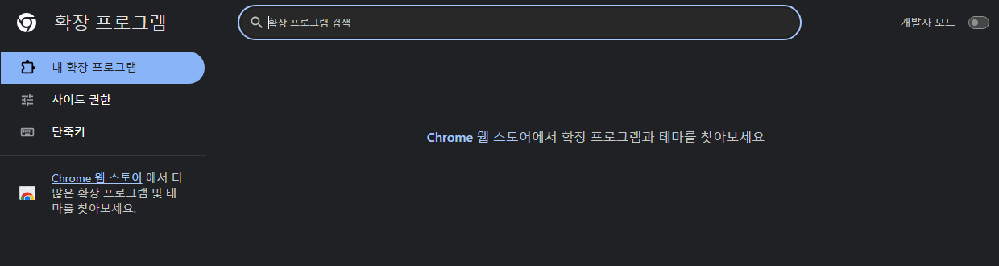
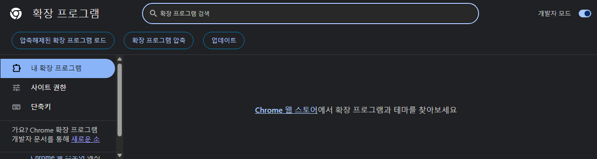
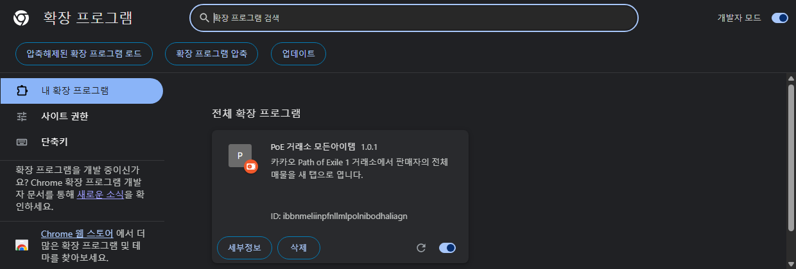
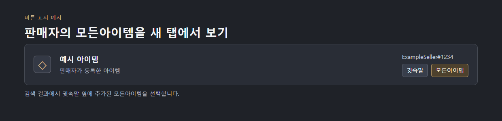

# PoE 거래소 모든아이템

카카오 **Path of Exile 1 거래소**에서 판매자의 공개 매물을 한 번에 보는 무료 브라우저 확장 프로그램입니다. 검색 결과의 **귓속말** 오른쪽에 **모든아이템**을 표시합니다. 즉시 구매 매물에서는 **은신처로 이동** 옆에 표시됩니다. 누르면 현재 리그의 해당 판매자 목록이 공식 거래소 새 탭에서 열립니다.

**[최신 버전 ZIP 다운로드](https://github.com/ez2sarang/poeUsersAllTradePlugIn/releases/latest/download/chrome-poe-all-items.zip)** · [릴리스 목록](https://github.com/ez2sarang/poeUsersAllTradePlugIn/releases)

## 설치 방법

1. 위 링크에서 `chrome-poe-all-items.zip`을 다운로드합니다. Windows에서는 ZIP을 오른쪽 클릭하고 **모두 압축 풀기**를 선택합니다. 압축을 푼 위치에서 `manifest.json`이 바로 들어 있는 `chrome-poe-all-items` 폴더를 찾습니다.
2. Chrome 주소창에 `chrome://extensions/`를 입력한 뒤 오른쪽 위 **개발자 모드**를 켭니다. Brave에서는 `brave://extensions/`로 이동합니다.

   

3. 왼쪽 위 **압축해제된 확장 프로그램 로드**를 누릅니다. 폴더 선택 창에서 `manifest.json`이 들어 있는 `chrome-poe-all-items` 폴더를 선택합니다. ZIP을 푼 바깥 폴더를 선택했다면 안쪽 폴더로 한 번 더 들어가세요.

   

4. 확장 프로그램 목록에 **PoE 거래소 모든아이템**이 보이고 활성화 스위치가 켜졌는지 확인합니다.

   

5. [카카오 PoE 1 아이템 거래소](https://poe.kakaogames.com/trade)로 이동합니다. 이미 열어 둔 거래소 탭은 새로고침하고, 아이템을 검색한 뒤 결과 행의 **모든아이템**을 눌러 봅니다.

   

## 기존 버전 업데이트

새 ZIP을 풀고, 기존에 로드한 폴더 안의 `manifest.json`과 `trade-results.js`를 새 파일로 교체합니다. 브라우저 확장 프로그램 관리 화면에서 **PoE 거래소 모든아이템** 카드의 새로고침 아이콘을 누른 뒤, 거래소 탭도 새로고침합니다.

1.0.1은 버튼이 공식 거래소 링크를 직접 열도록 변경했습니다. Chrome 계열 Chromium과 Brave에서 한글 계정, 새 탭, 같은 탭에서 리그를 바꾼 뒤의 동작을 확인했습니다.

## 문의

문제가 생기면 브라우저 종류, 확장 프로그램 버전, 거래소 리그를 함께 보내 주세요. 문의는 [sales@com.dooray.com](mailto:sales@com.dooray.com)으로 받습니다.

이 확장 프로그램은 커뮤니티에서 배포하는 무료 비공식 도구입니다.
